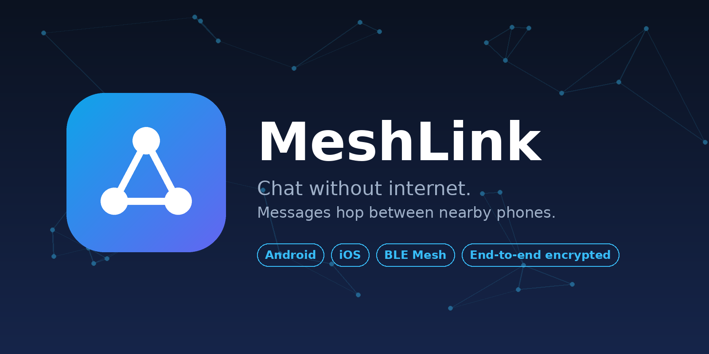

# MeshLink 📡

تطبيق محادثة **بدون إنترنت وبدون شبكة جوال**، يعتمد على بلوتوث (BLE) بنظام **Mesh**:
كل هاتف يعمل كعقدة تستقبل الرسالة وتعيد إرسالها للهواتف القريبة حتى تصل للمقصود.

```
هاتف A  ──►  هاتف B  ──►  هاتف C  ──►  هاتف D
```
المسافة الكلية ≈ عدد الهواتف في الطريق × مدى البلوتوث (30–100 متر لكل قفزة).

## المميزات
- 📡 مراسلة بدون إنترنت (BLE)
- 🔁 إعادة توجيه عبر الهواتف (Flooding + TTL + منع التكرار)
- 🔒 رسائل خاصة مشفرة من طرف لطرف (X25519 + ChaCha20-Poly1305)
- 📦 حفظ وإرسال لاحقاً (Store-and-Forward)
- ✓✓ تأكيد وصول الرسائل الخاصة
- 👤 اسم تختاره + اكتشاف تلقائي للأشخاص القريبين
- 🔔 إشعارات وتشغيل في الخلفية (Android: Foreground Service)
- 🎨 واجهة حديثة (فاتح/داكن) وأيقونة وشاشة افتتاحية

## المنصات
| المنصة | المجلد | المخرج |
|---|---|---|
| Android | `android/` | `.apk` |
| iOS | `ios/` | `.ipa` (يتولد المشروع من `project.yml` عبر XcodeGen) |

التطبيقان يتفقان على نفس البروتوكول: [`docs/PROTOCOL.md`](docs/PROTOCOL.md)

## حدود معروفة
- القنوات العامة غير مشفرة (الخاصة فقط مشفرة).
- بدون هواتف كافية في الطريق لن تصل الرسالة (تُخزَّن حتى يظهر جار).
- iOS يقيّد البلوتوث في الخلفية، فالعمل المستمر في الخلفية أقوى على Android.
- المفتاح الخاص يُحفظ حالياً في التخزين العادي (Keystore / Keychain مرحلة لاحقة).
- لا يوجد سرية أمامية (Forward Secrecy) بعد.

## خارطة الطريق
[`docs/ROADMAP.md`](docs/ROADMAP.md)

## الرخصة
MIT
